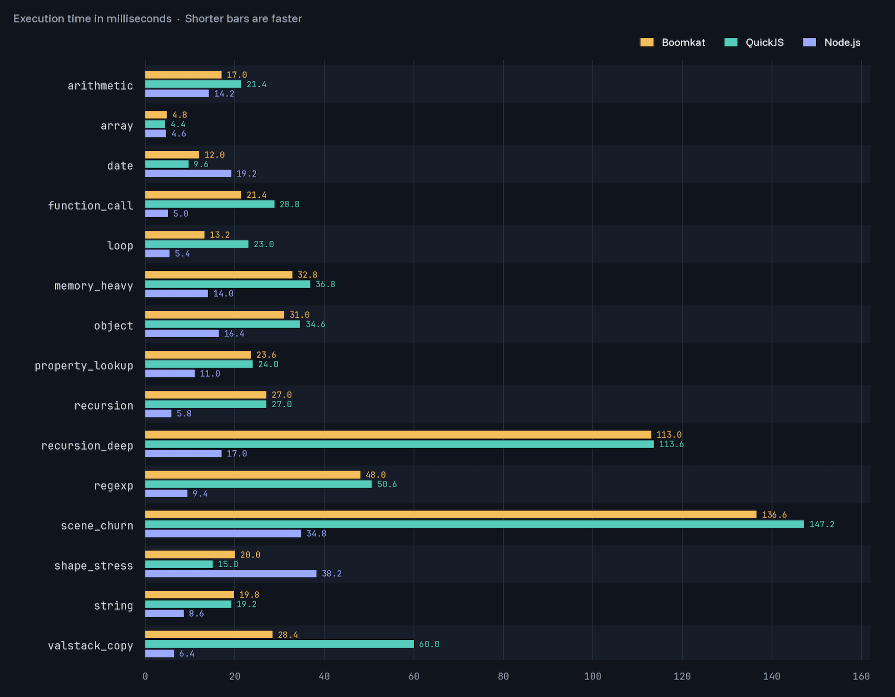

<br />
<div align="center">
  
  <h1 align="center">boomkat</h1>
  <p align="center">
    A modern, tiny Javascript engine with full ecma262 compliance
  </p>
  <p>
    &nbsp;
  </p>
</div>

<br>

**Boomkat** is a tiny and fast Javascript engine developed using the [C3](https://c3-lang.org/) language. It supports 100% of the [ES2025 spec](https://tc39.es/ecma262/2025/), has native TypeScript and JSX support, all in a binary under 3MB.

## AI disclosure

The boomkat engine is written using *AI-assisted engineering* - code written by machines, but heavily guided and edited by humans. It is a result of asking the question "how much can a solo engineer achieve using AI on a non-enterprise budget".

V8 and JSC have an estimated 1000+ human-years of development put into them, QuickJS about 10 years; Boomkat was developed in four months and about 400 human-hours of research, prompting and validating.

## Why

Boomkat started as an attempt to port [Duktape](https://duktape.org) to C3. I'm a long time user (thank you @svaarala), but it's showing its age, so I was looking for something small and embedabble to replace it.

After achieving parity with Duktape much earlier than expected, the next goal became to match QuickJS - achieved with a lot of effort and recent frontier models. The current goal is to get as close to V8/JSC as possible without a JIT compiler (we are not that far!). See comparison tables further down.

> *boomkat* is the dutch name for the [Margay](https://en.wikipedia.org/wiki/Margay), a small wild cat native to South America; translates to 'tree cat'. It fits with the tradition of animal-themed names for JS engines (like SpiderMonkey) and has a nice ring to it :)

## Features and compatibility

Boomkat passes 100% of the current standard ECMAScript feature set, excluding features in proposal stage, as measured with the [test262 conformance suite](https://github.com/tc39/test262).

- support for `Map/Set/ArrayBuffer/TypedArray/Proxy`, private fields, generators, dynamic imports, top-level await and other modern features
- Built-in support for **ES modules**
- Native support for **TypeScript** (type stripping, not type-checking) and **TSX/JSX**
- Easy embedding API for C and other languages

A full ECMAScript feature-by-feature breakdown against QuickJS, quickjs-ng, and
Duktape can be found in [docs/features.md](docs/features.md).

As part of it's validation suite, Boomkat is verified to run *lodash, underscore, moment, marked, handlebars, babel, papaparse, protobufjs* and other libraries. It is also verified to run *zustand, valtio, signals-core, jotai, fp-ts, zod* and the *typescript compiler* from their unmodified TypeScript sources, with results cross-checked against `tsc` output, Node and QuickJS.

## Performance

The engine is currently ~**10x** faster than Duktape, and overall **20%** faster than QuickJS, while using similar amounts of memory. The numbers below exclude startup/teardown costs.



## Security

_Use at your own risk_. At this stage the code has not yet been fully reviewed for security vulnerabilities. C3 facilitates memory management, but is not a fully memory-safe language.

## Getting started

The easiest way to try it out is by downloading the latest `boomkat-cli` release from the [Releases](/releases) page.

### Building from source

#### Requirements

- C3 compiler (v0.8.4+): `brew install c3c` | `pacman -S c3c`
- Just: `brew install just` | `pacman -S just`
- `python3` available in your PATH

Then `git clone https://github.com/ricardobeat/boomkat` and run `c3c build`. See `just --list` for a full list of available build outputs and tasks.

#### Build flags

- `-D TRACE_VM`: Enable bytecode disassembly and VM tracing
- `-D OP_PROFILE`: Enable opcode profiling
- `-D GC_PROFILE`: Enable GC profiling
- `-D NONANBOX`: disable NaN-boxing, 16-byte tagged union `TVal`
- `-D NOSHAPECACHE`: drop the per-object shape pointer cache
- `-D HEAP_VERIFY`: validate GC roots at yield/resume

See [docs/build-flags.md](docs/build-flags.md) for the full list.

### Slim and tiny builds

**SLIM** is a smaller build that is strict-only, excludes the builtin `console`, `Temporal`, `Intl`, `BigInt`, `Proxy`, typescript and jsx support to achive a roughly ~1.5MB binary size. Build with `just build-slim`.

**TINY** also excludes `RegExp`, `Map/Set`, `Iterators`, `SharedArrayBuffer` and a bunch of other modern features to achieve extreme size reduction. It is basically an ES2015 strict mode engine. It also *excludes the parser* and can only run precompiled bytecode:

```sh
just build-tiny
./out/boomkat_tiny_compile --compile program.bkbc program.js
./out/boomkat_tiny program.bkbc
```

The `boomkat_tiny` binary is **~700KB**. Async/await, generators, Date and JSON remain available.

## Language bindings

The engine ships a `bk_` C ABI (`include/boomkat.h`, static `boomkat.a` and a
shared library). See `docs/embedding.md`.

A quick example in C exposing a host function:

```c
#include <boomkat.h>
#include <stdio.h>

static void print(bk_ctx js, void *out) {
    const char *text = bk_cstr(js, bk_arg(js, 0), NULL);
    if (text) fprintf(out, "%s\n", text);
}

int main(void) {
    bk_ctx js = bk_open();
    if (!js) return 1;
    bk_register_fn(js, 0, "print", print, 1, 0u, stdout);
    int failed = bk_exec(js, "print('Hello, world from Boomkat!')");
    if (failed) fprintf(stderr, "JavaScript: %s\n", bk_error(js));
    bk_close(js);
    return failed;
}
```

This example is available at [bindings/c/hello.c](bindings/c/hello.c). Build the static library with `just build-lib`, then run `just example-c-hello`.

> Bindings for Go, Rust, Python, Ruby, and Zig are currently a work in progress.

## License

Use of this software is governed by the Business Source License included in the [LICENSE](./LICENSE) file.

tl;dr Boomkat can be used without restrictions for open-source, personal and commercial projects up to $2M/year revenue, and each release becomes MIT-licensed after four years.

## Support this project

[](https://github.com/sponsors/ricardobeat)
