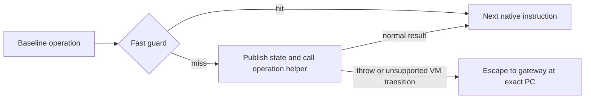

# 110: A native execution convention, reliable baseline, and compact optimizer

Status: investigated and designed, 2026-10-27. Runtime performance experiments
were rejected; SLJIT binding tests and coverage diagnostics are implemented on
`rat`. This is a proposed engine architecture, not a claim that the engine has
reached its performance target. It supersedes the ordering of plans 107–108.

The target is between QuickJS/Hermes and V8/JSC. The useful next unit of work is
a connected native call graph with correct slow-path continuations. Adding
another speculative opcode to the current region tier does not establish that.

## 1. What is actually happening

Baseline: `a36d275b`, default O2 CLI, NaN boxing, Apple silicon arm64, macOS 27,
C3 0.8.5 / LLVM 23.1.3. Nine samples per engine, sequential runs with engine
order reversed on alternating rounds, fresh process per sample. The table uses
the minis' own timed intervals, including JIT warmup; process wall times are
also recorded. Richards runs 100 iterations and DeltaBlue 60.

| mini | Boomkat interpreter | Boomkat JIT | QuickJS 2025-09-13 | QuickJS-ng 0.17 | V8 / Node 26.12 | system JSC |
|---|---:|---:|---:|---:|---:|---:|
| Richards | 226 ms | 165 ms | 238 ms | 290 ms | 8 ms | 11 ms |
| DeltaBlue | 252 ms | 245 ms | 257 ms | 292 ms | 9 ms | 10 ms |
| Splay | 107 ms | 108 ms | 107 ms | 134 ms | 12 ms | 13 ms |

All engines ran classic scripts. Node used `vm.runInThisContext`; QuickJS-ng
required `--script` to avoid its module autodetection. Hermes was unavailable
and was not measured. These are these particular minis, not aggregate engine
rankings. [Raw runs](110-native-jit-pipeline/engine-matrix.json).

An illustrative geometric midpoint between measured QuickJS and V8 is about
44 ms Richards and 48 ms DeltaBlue. That makes 45–60 ms a useful *proposed*
longer-term target, requiring roughly 3–5x over today's JIT. A 4% opcode win
is not evidence that this architectural goal is being met.

### Execution-weighted evidence

Diagnostic builds used `SLJIT_STATS` and `OP_PROFILE`; none of their timings
were used in the performance table. The executed interpreter-bytecode counts
include fused instructions but exclude work executed by generated code:

| mini | interpreted, JIT off | interpreted, JIT on | reduction | wall-time improvement |
|---|---:|---:|---:|---:|
| Richards | 65,342,961 | 30,769,016 | 52.9% | 27.0% |
| DeltaBlue | 58,475,378 | 47,175,877 | 19.3% | 2.8% |
| Splay | 25,178,848 | 24,902,443 | 1.1% | none |

These are interpreter counts, not a native-time percentage. The JIT saves
dispatches but spends much of the saving crossing region and call boundaries.
[Counter totals](110-native-jit-pipeline/dispatch-totals.json).

The new census counts threaded handler entries separately from switch
instructions, since refused handlers can be retried. It exposes hot functions
even when compilation failed or their entry was permanently disabled:

| Richards function | threaded entries with JIT | why still interpreted |
|---|---:|---|
| `TaskControlBlock.run` | 10,321,079 | entry retired at numeric `JMP_NEQ` |
| `HandlerTask.run` | 6,207,093 | entries retired at numeric comparison / calls |
| `Scheduler.queue` | 4,876,048 | entry retired at call |
| `DeviceTask.run` | 2,869,038 | entry retired at calls |
| `IdleTask.run` | 2,098,561 | entry retired at numeric comparison |
| `WorkerTask.run` | 1,820,638 | region retired at indexed store |

The first six account for about 91.5% of remaining threaded entries. Richards'
674k return exits are real, but describe the functions that *still run* in the
tier; they hide the dominant functions that stopped trying.

| DeltaBlue function | threaded entries with JIT | admission / exit |
|---|---:|---|
| `Plan.execute` | 9,561,557 | loop entry retired at call to `constraintAt` |
| `EqualityConstraint.execute` | 6,732,000 | no entry reaches minimum span |
| `BinaryConstraint.output` | 4,938,120 | no entry reaches minimum span |
| `Plan.size` | 4,428,000 | no entry reaches minimum span |
| `BinaryConstraint.input` | 4,214,520 | no entry reaches minimum span |
| `OrderedCollection.size` | 2,568,000 | no entry reaches minimum span |

Those six account for about 68.8% of remaining threaded entries. Compiling
`constraintAt` while rejecting `size`, `input`, `output`, and `execute` cannot
turn the constraint graph into sustained native execution. Splay similarly
spends most remaining work in `GeneratePayloadTree` and `SplayTree.splay`;
they fail the useful-operation and entry-span policies respectively.

Reports with exact IDs, source lines and exit opcodes:
[Richards](110-native-jit-pipeline/richards-report.txt),
[DeltaBlue](110-native-jit-pipeline/deltablue-report.txt),
[Splay](110-native-jit-pipeline/splay-report.txt).

### CPU sampling and machine code

Three-second `sample` runs over 6,000-iteration variants confirm that interpreter
handlers dominate. DeltaBlue's largest leaves are `th_call` (467 samples),
`th_try_fast_return` (347), `th_getpropc_cached` (336), `th_ldreg` (166), and
`th_resume_caller` (155). Richards also has substantial `vm_call_lean`,
`th_return_entry`, and `sljit_function_entry` overhead.

LLDB observes generated code calling `sljit_native_call`, then `vm_call_lean`.
The latter allocates a 432-byte native frame before doing callback setup.
Disassembly contains 333 instructions in `sljit_function_entry`, 170 in
`sljit_native_call`, and 434 in `vm_call_lean`, including their slow branches.
These are static sizes, not instructions executed on every call. They expose
why a small JS callee cannot cheaply amortize this path.

[Richards sample](110-native-jit-pipeline/richards-baseline.sample),
[DeltaBlue sample](110-native-jit-pipeline/deltablue-baseline.sample),
[LLDB call stack](110-native-jit-pipeline/native-call-lldb.txt),
[disassembly](110-native-jit-pipeline/baseline-entry-disassembly.txt).

## 2. Experiments that did not meet the target

Each pair used the same benchmark, sequential interleaved executions, and
medians. Small differences between baseline columns are run-to-run variation.

| experiment | Richards before → after | DeltaBlue before → after | decision |
|---|---:|---:|---|
| direct compiled entry / return inside existing host-call setup, 7 pairs | 167 → 170 | 246 → 248 | reject |
| C dispatcher carrying normal VM frames across native regions, 5 pairs | 166 → 167 | 244 → 283 | reject |
| numeric loose equality in existing regions, 7 pairs | 166 → 167 | 243 → 246 | insufficient alone |
| C dispatcher + numeric equality, 7 pairs | 166 → 159 | 245 → 285 | reject |

The dispatcher prototype preserves VM activations on a side exit and directly
pops ordinary uncounted return frames. It still calls the expensive region
entry wrapper at each transfer. Merely bypassing the threaded return handler
does not provide a native calling convention. Its policies also admit more
short prefixes, which costs DeltaBlue substantially.

Numeric `==`/`!=` was a real missing fast case: the current loose-equality
emitter handles nullish values and object identity but exits for two numbers.
Adding it exposes the *next* property/call exit and the entry then retires
there. None of these experiments is retained in the execution path.

[Measurements](110-native-jit-pipeline/experiment-summary.json) and patches:
[direct return](110-native-jit-pipeline/direct-return.patch),
[dispatcher](110-native-jit-pipeline/transfers-v2.patch),
[numeric equality](110-native-jit-pipeline/numeric-equality.patch),
[combined](110-native-jit-pipeline/transfers-numeric.patch).
They are research snapshots against `a36d275b`, not production patches; the
combined snapshot includes diagnostic fields used during the investigation.

## 3. Correctness before performance attribution

The unmodified baseline's 15 mini scripts were compared with JIT off/on,
normalizing only printed timings and checking exit status. Thirteen match.
`crypto` exits with `Crypto operation failed` under JIT; `gbemu` times out at
45 seconds under JIT while completing around 246 ms interpreted. Matching
printed outputs is limited to the assertions and outputs those minis expose.

Disabling only `sljit_loop_entry` makes Crypto pass, albeit slowly; it does
not resolve Gameboy's timeout. SSA was already disabled. This localizes Crypto
to the loop-tier configuration but does not identify its exact faulty
instruction. Gameboy remains an independent unresolved gate.

[Full results](110-native-jit-pipeline/mini-correctness.json),
[loop isolation](110-native-jit-pipeline/loop-isolation.json).

ASan found another pre-existing defect in `loop_analyze`: the `charCodeAt` and
`Math.imul` admission paths indexed the `LOOP_REGS`-element frequency array with a source ID
that can name a captured/global binding (`LOOP_REGS + binding`). This overruns
the stack array. Both paths now count only register sources, as the other
property path already did. The existing `hash` fixture reproduces the imul
case; `asciiBinding` adds the captured-string case and confirms native loop
execution. The ASan embedding suite and all three target minis pass after the
fix. Crypto and Gameboy still fail independently.

Do not reuse Crypto's invalid fast result as a speedup. Add the mini assertions
and timeouts to the recurring gates alongside differential local/rosetta/module
and test262 runs. Preserve strict scripts, sloppy scripts, modules and class
semantics. Every new native regression must demonstrate native execution with
counters, not just pass while interpreted.

## 4. Layer one: a native execution convention

The bundled SLJIT revision is `39c508d1b8fbae332d60c7450db20236913089da`.
It already supplies the necessary machine-code building blocks:

| facility | use | boundary |
|---|---|---|
| `SLJIT_ENTER_REG_ARG` / `SLJIT_CALL_REG_ARG` | generated-to-generated calls with scratch arguments | never call such an entry directly through a C function pointer |
| `SLJIT_ENTER_KEEP(1..3)` | shared S0..S2 context | at most three shared registers; remaining saved registers obey normal preservation |
| `sljit_set_context` | separately generated slow fragments / continuations | identical register counts, entry options, argument types and local stack size |
| `sljit_emit_call`, `sljit_set_target` | initial linking | retain metadata before freeing the compiler |
| `SLJIT_REWRITABLE_JUMP`, `sljit_set_jump_addr` | changing compiled callees and IC stubs | retain jump address and executable offset; use SLJIT's patch API |
| `sljit_emit_return_to` | possible future nonlocal generated transfer | not a substitute for VM exception semantics |

See bundled `vendor/sljit/sljit_src/sljitLir.h`, especially lines 902–979,
1835–1865, and 2480–2495. `FAST_CALL` is a different mechanism with explicit
return-address handling; do not confuse it with `CALL_REG_ARG` or use it as a
shortcut around recursion, unwind or shadow-stack requirements.

The missing bindings and opaque-structure shims are now exposed. The embedding
test exercises an outer C entry, two nested internal calls, shared context in
S0 and callee mutations of S1/S2, a C helper, an independently compiled same-context
fragment, and repatched calls and branches after compiler objects are freed.
The complete embedding test passes on arm64, including under ASan. An isolated
run of the same ABI test also passes with `SLJIT_DEBUG=1` on arm64 and x86-64
(Rosetta). This validates the building blocks; it does not yet execute JS
using the new convention.

### Proposed ABI

One outer C-compatible gateway enters a native run. Internal generated
functions use `ENTER_REG_ARG | ENTER_KEEP(3)`:

| location | meaning |
|---|---|
| S0 | `NativeRun*`: VM/heap, shared budgets, exit status, code-lifetime records |
| S1 | current `Activation*` |
| S2 | current activation's register window |
| R0 on return | normal/escape status; the JS result already owns its VM destination slot |
| other scratch registers | temporary values, clobbered by calls |
| additional saved registers | per-function allocation under SLJIT's preservation rules |

Define the ABI once in C3, with one context descriptor used by normal entries,
resume entries and fragments. Do not distribute register numbers and stack
sizes through the individual emitters.

**Frame ownership.** Reuse the sliding register-window layout and ordinary
`Activation` stack. Arguments transfer ownership as in `th_enter_lean`; do not
copy every argument into a host callback frame or replace the active stack
with shadow segments on every JS call. Factor frame publication and cleanup
from existing helpers so all fields, borrowed-callee rules, `this`, realm,
argument counts and scratch extents retain their established semantics.

**Call and return.** A hot call guards the callee/entry, checks frame space and
budgets, publishes the callee activation, and issues an internal call. A normal
callee return retains/stores the result in the caller's destination *before*
releasing callee slots, then restores S1/S2 and the VM's current frame and
returns directly to the generated continuation. Strings require the existing
retain/release rules; returning an object still requires GC publication.

**Roots and helpers.** Initial baseline code keeps VM slots authoritative.
Before an allocating, reentrant or throwing helper, publish the exact PC,
register values, ownership and root watermark. A helper may grow the value
stack: reload S2 from `act.bottom` afterward, including any scratch pointers.
An activation pointer remains stable. No borrowed string cache may cross a
helper under the current emitter's assumption that no call or allocation
occurs before cache reconciliation. Invalidate heap/type/shape facts according
to the helper's effects. Calls during incremental marking must shade all
newly published roots and stores.

Operation helpers return an explicit completion/throw/escape status. Their
contract says whether the operation has taken effect and which PC resumes;
continuation metadata distinguishes the suspended call instruction from its
normal successor. Preserve the interpreter's existing exception-PC convention.
An allocation or generic operation that completed must never be retried merely
because a later guard failed.

**Fallback without replay.** A true side exit records the current VM frame and
exact instruction, materializes state, and returns escape status through the
generated callers. These epilogues release native machine frames but do not
pop the still-live VM activations or run JS continuations. The outer gateway
resumes the interpreter at the deepest live frame. When the interpreter later
reaches a compiled continuation, a resume entry establishes the required
machine frame and jumps to its bytecode-to-native label. No store, getter or
call is executed twice.

**Exceptions.** A throwing helper records the ordinary pending exception and
the throwing instruction. Escape status unwinds native frames to the gateway;
existing VM unwinding then runs catch/finally and pops VM frames once. Interrupt
exceptions retain their uncatchable behavior. Do not use C `longjmp`, skip
native epilogues, or treat returning an undefined value as an exception status.

**Budgets.** Charge shared backedge *and call* budgets, including recursive
native calls with no loop. Native stack usage needs its own limit in addition
to `MAX_CALLS`; at that limit escape to ordinary VM execution. Test deep
recursion, host reentry, watchdog interruption, stack relocation and OOM.

**Code lifetime and linking.** Start with indirect entries in compiled-function
metadata. Add direct patched sites only once retirement tracks incoming links
or redirects them through stable entry stubs. Invalidating a plan must not free
code containing a live machine return address. Keep active code rooted and
defer its reclamation until those activations leave. Same-context fragments
share that lifetime contract. Patching occurs on the engine thread at a safe
transition and uses the saved executable offset, including on W^X platforms.

This is the first performance milestone: the measured call graphs run through
generated calls/returns, without `vm_call_lean` or an interpreter burst on a
normal native edge. A C dispatcher can remain a cold gateway; it must not be
the hot per-callee ABI.

## 5. Layer two: reliable baseline compilation

Compile ordinary hot functions with complete continuation coverage. A short
helper's cost is its cheap native ABI, not whether its longest guarded prefix
contains six or sixteen bytecodes. Select compilation using execution weight
and code budget, not `useful >= 2` plus a prefix span. Large functions may use
same-context fragments, but every reachable supported continuation must have
a valid entry and every other operation must have defined fallback semantics.

Reuse the existing emitters where sound, but make common misses local:



A property cache miss updates the IC and returns to the compiled continuation.
A numeric comparison handles int/int, mixed int/double, doubles, NaN and signed
zero; coercing cases call the semantic helper. Array growth, general stores and
builtin calls similarly use operation helpers. Calling an existing threaded
handler that proceeds into `th_next` is not such a helper.

Keep mutable baseline ICs for own reads, prototype reads, writes, method calls
and indexed elements. Guard receiver shape/generation, prototype epoch, owner
and slot as appropriate; preserve missing properties, accessors, proxies,
strict-mode errors and write barriers. Cache mutation or a new receiver shape
should not permanently disable a whole baseline entry.

Replace the eight-short-runs rule with separate policies: baseline remains
semantically general; speculation failures cool or retire an *optimized*
version. Keep a stable baseline destination while gathering new feedback.
Account code and metadata separately: today's 512-element exit histogram is
already 4 KiB per function plan, even in a normal build. Detailed diagnostics
should be opt-in before scaling baseline coverage.

Use one decoded opcode/effects description: reads, writes, control successors,
allocation, user-code invocation, throwing, and resume behavior. Sharing this
contract does not require identical machine-code implementations in all tiers.
Do not infer support from enum ordinal ranges alone.

## 6. Layer three: a compact optimizer in C3

Once native calls and baseline continuations work, build a bounded optimizer
over a common CFG/IR. SLJIT is the machine-code backend, not the optimizer.

1. Build blocks and explicit value/effect dependencies from bytecode. Gather
   argument, return, numeric representation, receiver-shape and callee feedback
   in the baseline. Identify phi inputs and liveness at joins.
2. Propagate int/double/tag and bounded shape sets. Eliminate redundant loads
   and guards only while aliasing, prototype epochs and call effects permit it.
   A helper that invokes user code kills the relevant heap facts.
3. Keep numeric values unboxed across blocks. Handle int overflow, NaN,
   negative zero and boxing exactly; allocate registers with a small linear
   scan, including phi moves, call clobbers and spill locations.
4. Inline measured monomorphic or small polymorphic callees under code-size
   and depth budgets. Each deopt point records the complete inline frame chain,
   function/closure, receiver, bytecode PC, locals and materialization recipes.
   Resume after completed effects; never rerun an entire mutated callee.
5. Use baseline as the deoptimization target. Recompile only when new feedback
   justifies it, and bound compile time, code size and metadata for small hosts.

The disabled SSA implementation and specialized loop/template paths are sources
of reusable pieces, not additional independently growing execution contracts.
Their correctness and measured value must be established before consolidation.

This order is consistent with the interpreter-compatible frame strategy in
[V8 Sparkplug](https://v8.dev/blog/sparkplug) and the baseline-to-optimizer
division in [JavaScriptCore](https://webkit.org/blog/10308/speculation-in-javascriptcore/).
Those engines motivate the design; they do not establish Boomkat's speedup.

## 7. Sequence and acceptance

1. **Foundation, implemented here:** expose and exercise SLJIT's convention,
   context and patching APIs; add the function census and readable exit IDs.
2. **Correctness gates:** minimize Crypto and Gameboy; gate all 15 minis as well
   as existing differential suites. Keep invalid results out of timing reports.
3. **Native execution slice:** one compiled caller/callee/return path with real
   VM activations; test normal result, side exit after a store, exceptions,
   strings, GC, stack relocation, recursion and interrupt. Validate arm64 and
   x86-64 before treating the ABI as portable. Measure against the host-helper
   path, including code/metadata cost.
4. **Baseline continuity:** close the exact Richards/DeltaBlue graphs above,
   with local slow paths and stable continuations. Require a repeatable
   double-digit end-to-end gain on both targets, and investigate regressions
   outside noise on Splay and the other minis. The targets are gates for a
   candidate, not promised outcomes.
5. **Optimizer:** implement the bounded passes above, measuring toward the
   proposed 45–60 ms region while retaining the baseline and correctness gates.

Every measurement records revision, compiler/features, engine versions,
benchmark iteration counts, internal and whole-process time, native code and
metadata bytes, RSS, compile latency, interpreter dispatch counts, and exits by
source location. Separate startup from longer warm runs. Use generated-address
maps to attribute samples; native hits and return exits alone are insufficient.

The experiments show why the earlier work plateaued. Its unit of optimization
was a guarded prefix; the workloads' unit of work is a connected graph of tiny
methods. The new convention and baseline make that graph executable natively;
the compact optimizer then removes the repeated work inside it.

## 8. Delivered changes and validation

Local commits on `rat`, based on `a36d275b`:

- `9ba138d4`: fix the loop intrinsic frequency-array overflow and add captured
  string coverage.
- `4a06f3b6`: expose the SLJIT APIs and add the generated-code ABI test.
- `e081bcd1`: add opt-in function coverage/admission diagnostics and
  `scripts/report_jit.py`.

The retained changes do not implement the proposed JS calling convention or
claim a throughput improvement. Five final interleaved pairs against the
baseline are neutral: Richards 167 → 166 ms, DeltaBlue 246 → 246 ms, Splay
110 → 110 ms. [Final timings](110-native-jit-pipeline/final-timings.json).

Validation: 51/51 JIT fixture/mode runs; normal and ASan embedding suites;
ASan Richards, DeltaBlue and Splay; isolated SLJIT assertion-enabled ABI checks
on arm64 and x86-64/Rosetta; local/rosetta/modules JIT differential outputs
match. The default local suite has the same 27 failures at baseline and final
(652 passes), including unavailable Intl/Temporal features; a differential
match does not mean all local tests passed. Test262 was not rerun here.
[Validation metadata](110-native-jit-pipeline/validation.json),
[ASan before](110-native-jit-pipeline/asan-abi.txt),
[ASan after](110-native-jit-pipeline/asan-abi-fixed.txt).

To reproduce the census from the `rat` checkout:

```sh
c3c build boomkat -D SLJIT_STATS -D OP_PROFILE --macos-min-version 27.0 \
  --build-dir /tmp/bk-jit-profile-build --output-dir /tmp/bk-jit-profile
/tmp/bk-jit-profile/boomkat --jit --stats --script bench/mini/deltablue.js \
  > /tmp/deltablue.stats 2>&1
python3 scripts/report_jit.py /tmp/deltablue.stats --source bench/mini/deltablue.js
```

The deployment-target flag is specific to this machine. Use the normal
uninstrumented `just build boomkat` binary for timing. Build the embedding
test with `c3c build embedding_jit --sanitize=address` in a separate build and
output directory to reproduce the sanitizer check. The standalone x86-64 ABI
check explicitly compiled its C sources with `-arch x86_64`; C3's `--target`
alone left those C objects at the host architecture in this setup.
