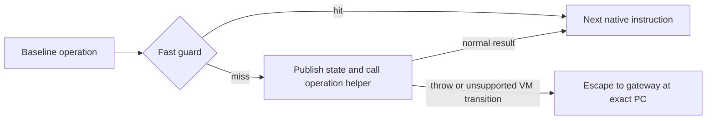

# 110: A native execution convention, reliable baseline, and compact optimizer

Status: recoverable inlining, allocating continuations, patchable native calls
and guarded cross-block numeric homes implemented, 2026-10-27.
Sections 11–12 record the new implementation, measurements, profiling and
validation. The compact optimizer remains deliberately restricted; a general
SSA optimizer and a further 10× gain are not established. This supersedes the
ordering of plans 107–108.

The target is between QuickJS/Hermes and V8/JSC. The useful unit of work is a
connected native call graph with correct slow-path continuations. Adding
another speculative opcode to a region tier does not establish that.

## 1. What is actually happening

Baseline: `a36d275b`, default O2 CLI, NaN boxing, Apple silicon arm64, macOS 27,
C3 0.8.5 / LLVM 23.1.3. Nine samples per engine, sequential runs with engine
order reversed on alternating rounds, fresh process per sample. The table uses
the minis' own timed intervals, including JIT warmup; process wall times are
also recorded. Richards runs 100 iterations and DeltaBlue 60.

| mini | Boomkat interpreter | Boomkat JIT | QuickJS 2025-09-13 | QuickJS-ng 0.17 | V8 / Node 26.12 | system JSC |
|---|---:|---:|---:|---:|---:|---:|
| Richards | 226 ms | 165 ms | 238 ms | 290 ms | 8 ms | 11 ms |
| DeltaBlue | 252 ms | 245 ms | 257 ms | 292 ms | 9 ms | 10 ms |
| Splay | 107 ms | 108 ms | 107 ms | 134 ms | 12 ms | 13 ms |

All engines ran classic scripts. Node used `vm.runInThisContext`; QuickJS-ng
required `--script` to avoid its module autodetection. Hermes was unavailable
and was not measured. These are these particular minis, not aggregate engine
rankings. [Raw runs](110-native-jit-pipeline/engine-matrix.json).

An illustrative geometric midpoint between measured QuickJS and V8 is about
44 ms Richards and 48 ms DeltaBlue. That makes 45–60 ms a useful *proposed*
longer-term target, requiring roughly 3–5x over today's JIT. A 4% opcode win
is not evidence that this architectural goal is being met.

### Execution-weighted evidence

Diagnostic builds used `SLJIT_STATS` and `OP_PROFILE`; none of their timings
were used in the performance table. The executed interpreter-bytecode counts
include fused instructions but exclude work executed by generated code:

| mini | interpreted, JIT off | interpreted, JIT on | reduction | wall-time improvement |
|---|---:|---:|---:|---:|
| Richards | 65,342,961 | 30,769,016 | 52.9% | 27.0% |
| DeltaBlue | 58,475,378 | 47,175,877 | 19.3% | 2.8% |
| Splay | 25,178,848 | 24,902,443 | 1.1% | none |

These are interpreter counts, not a native-time percentage. The JIT saves
dispatches but spends much of the saving crossing region and call boundaries.
[Counter totals](110-native-jit-pipeline/dispatch-totals.json).

The new census counts threaded handler entries separately from switch
instructions, since refused handlers can be retried. It exposes hot functions
even when compilation failed or their entry was permanently disabled:

| Richards function | threaded entries with JIT | why still interpreted |
|---|---:|---|
| `TaskControlBlock.run` | 10,321,079 | entry retired at numeric `JMP_NEQ` |
| `HandlerTask.run` | 6,207,093 | entries retired at numeric comparison / calls |
| `Scheduler.queue` | 4,876,048 | entry retired at call |
| `DeviceTask.run` | 2,869,038 | entry retired at calls |
| `IdleTask.run` | 2,098,561 | entry retired at numeric comparison |
| `WorkerTask.run` | 1,820,638 | region retired at indexed store |

The first six account for about 91.5% of remaining threaded entries. Richards'
674k return exits are real, but describe the functions that *still run* in the
tier; they hide the dominant functions that stopped trying.

| DeltaBlue function | threaded entries with JIT | admission / exit |
|---|---:|---|
| `Plan.execute` | 9,561,557 | loop entry retired at call to `constraintAt` |
| `EqualityConstraint.execute` | 6,732,000 | no entry reaches minimum span |
| `BinaryConstraint.output` | 4,938,120 | no entry reaches minimum span |
| `Plan.size` | 4,428,000 | no entry reaches minimum span |
| `BinaryConstraint.input` | 4,214,520 | no entry reaches minimum span |
| `OrderedCollection.size` | 2,568,000 | no entry reaches minimum span |

Those six account for about 68.8% of remaining threaded entries. Compiling
`constraintAt` while rejecting `size`, `input`, `output`, and `execute` cannot
turn the constraint graph into sustained native execution. Splay similarly
spends most remaining work in `GeneratePayloadTree` and `SplayTree.splay`;
they fail the useful-operation and entry-span policies respectively.

Reports with exact IDs, source lines and exit opcodes:
[Richards](110-native-jit-pipeline/richards-report.txt),
[DeltaBlue](110-native-jit-pipeline/deltablue-report.txt),
[Splay](110-native-jit-pipeline/splay-report.txt).

### CPU sampling and machine code

Three-second `sample` runs over 6,000-iteration variants confirm that interpreter
handlers dominate. DeltaBlue's largest leaves are `th_call` (467 samples),
`th_try_fast_return` (347), `th_getpropc_cached` (336), `th_ldreg` (166), and
`th_resume_caller` (155). Richards also has substantial `vm_call_lean`,
`th_return_entry`, and `sljit_function_entry` overhead.

LLDB observes generated code calling `sljit_native_call`, then `vm_call_lean`.
The latter allocates a 432-byte native frame before doing callback setup.
Disassembly contains 333 instructions in `sljit_function_entry`, 170 in
`sljit_native_call`, and 434 in `vm_call_lean`, including their slow branches.
These are static sizes, not instructions executed on every call. They expose
why a small JS callee cannot cheaply amortize this path.

[Richards sample](110-native-jit-pipeline/richards-baseline.sample),
[DeltaBlue sample](110-native-jit-pipeline/deltablue-baseline.sample),
[LLDB call stack](110-native-jit-pipeline/native-call-lldb.txt),
[disassembly](110-native-jit-pipeline/baseline-entry-disassembly.txt).

## 2. Experiments that did not meet the target

Each pair used the same benchmark, sequential interleaved executions, and
medians. Small differences between baseline columns are run-to-run variation.

| experiment | Richards before → after | DeltaBlue before → after | decision |
|---|---:|---:|---|
| direct compiled entry / return inside existing host-call setup, 7 pairs | 167 → 170 | 246 → 248 | reject |
| C dispatcher carrying normal VM frames across native regions, 5 pairs | 166 → 167 | 244 → 283 | reject |
| numeric loose equality in existing regions, 7 pairs | 166 → 167 | 243 → 246 | insufficient alone |
| C dispatcher + numeric equality, 7 pairs | 166 → 159 | 245 → 285 | reject |

The dispatcher prototype preserves VM activations on a side exit and directly
pops ordinary uncounted return frames. It still calls the expensive region
entry wrapper at each transfer. Merely bypassing the threaded return handler
does not provide a native calling convention. Its policies also admit more
short prefixes, which costs DeltaBlue substantially.

Numeric `==`/`!=` was a real missing fast case: the current loose-equality
emitter handles nullish values and object identity but exits for two numbers.
Adding it exposes the *next* property/call exit and the entry then retires
there. None of these experiments is retained in the execution path.

[Measurements](110-native-jit-pipeline/experiment-summary.json) and patches:
[direct return](110-native-jit-pipeline/direct-return.patch),
[dispatcher](110-native-jit-pipeline/transfers-v2.patch),
[numeric equality](110-native-jit-pipeline/numeric-equality.patch),
[combined](110-native-jit-pipeline/transfers-numeric.patch).
They are research snapshots against `a36d275b`, not production patches; the
combined snapshot includes diagnostic fields used during the investigation.

## 3. Correctness before performance attribution

The unmodified baseline's 15 mini scripts were compared with JIT off/on,
normalizing only printed timings and checking exit status. Thirteen match.
`crypto` exits with `Crypto operation failed` under JIT; `gbemu` times out at
45 seconds under JIT while completing around 246 ms interpreted. Matching
printed outputs is limited to the assertions and outputs those minis expose.

Disabling only `sljit_loop_entry` makes Crypto pass, albeit slowly; it does
not resolve Gameboy's timeout. SSA was already disabled. This localizes Crypto
to the loop-tier configuration but does not identify its exact faulty
instruction. Gameboy remains an independent unresolved gate.

[Full results](110-native-jit-pipeline/mini-correctness.json),
[loop isolation](110-native-jit-pipeline/loop-isolation.json).

ASan found another pre-existing defect in `loop_analyze`: the `charCodeAt` and
`Math.imul` admission paths indexed the `LOOP_REGS`-element frequency array with a source ID
that can name a captured/global binding (`LOOP_REGS + binding`). This overruns
the stack array. Both paths now count only register sources, as the other
property path already did. The existing `hash` fixture reproduces the imul
case; `asciiBinding` adds the captured-string case and confirms native loop
execution. The ASan embedding suite and all three target minis pass after the
fix. Crypto and Gameboy still fail independently.

Do not reuse Crypto's invalid fast result as a speedup. Add the mini assertions
and timeouts to the recurring gates alongside differential local/rosetta/module
and test262 runs. Preserve strict scripts, sloppy scripts, modules and class
semantics. Every new native regression must demonstrate native execution with
counters, not just pass while interpreted.

## 4. Layer one: a native execution convention

The bundled SLJIT revision is `39c508d1b8fbae332d60c7450db20236913089da`.
It already supplies the necessary machine-code building blocks:

| facility | use | boundary |
|---|---|---|
| `SLJIT_ENTER_REG_ARG` / `SLJIT_CALL_REG_ARG` | generated-to-generated calls with scratch arguments | never call such an entry directly through a C function pointer |
| `SLJIT_ENTER_KEEP(1..3)` | shared S0..S2 context | at most three shared registers; remaining saved registers obey normal preservation |
| `sljit_set_context` | separately generated slow fragments / continuations | identical register counts, entry options, argument types and local stack size |
| `sljit_emit_call`, `sljit_set_target` | initial linking | retain metadata before freeing the compiler |
| `SLJIT_REWRITABLE_JUMP`, `sljit_set_jump_addr` | changing compiled callees and IC stubs | retain jump address and executable offset; use SLJIT's patch API |
| `sljit_emit_return_to` | possible future nonlocal generated transfer | not a substitute for VM exception semantics |

See bundled `vendor/sljit/sljit_src/sljitLir.h`, especially lines 902–979,
1835–1865, and 2480–2495. `FAST_CALL` is a different mechanism with explicit
return-address handling; do not confuse it with `CALL_REG_ARG` or use it as a
shortcut around recursion, unwind or shadow-stack requirements.

The missing bindings and opaque-structure shims are now exposed. The embedding
test exercises an outer C entry, two nested internal calls, shared context in
S0 and callee mutations of S1/S2, a C helper, an independently compiled same-context
fragment, and repatched calls and branches after compiler objects are freed.
The complete embedding test passes on arm64, including under ASan. An isolated
run of the same ABI test also passes with `SLJIT_DEBUG=1` on arm64 and x86-64
(Rosetta). This initially validated the building blocks; section 9 records
their use for actual JS calls and returns.

### Implemented ABI

One outer C-compatible gateway enters a native run. Internal generated
functions use `ENTER_REG_ARG | ENTER_KEEP(3)`:

| location | meaning |
|---|---|
| S0 | current activation's register window |
| S1 | `ColdCtx*`, including the current VM and activation |
| S2 | `FunctionRun*`, including root activation, depth and shared budget |
| R0 on return | null for a completed native return; otherwise the exact absolute resume PC in the deepest live VM activation |
| other scratch registers | temporary values, clobbered by calls |
| additional saved registers | per-function allocation under SLJIT's preservation rules |

The gateway uses the C ABI; the shared body and call entry use seven scratch
GPRs, six saved GPRs and six scratch FP registers. Consolidating this context
description before adding separately compiled operation fragments remains
follow-up work.

**Frame ownership.** Reuse the sliding register-window layout and ordinary
`Activation` stack. Arguments transfer ownership as in `th_enter_lean`; do not
copy every argument into a host callback frame or replace the active stack
with shadow segments on every JS call. Factor frame publication and cleanup
from existing helpers so all fields, borrowed-callee rules, `this`, realm,
argument counts and scratch extents retain their established semantics.

**Call and return.** A hot call guards the callee/entry, checks frame space and
budgets, publishes the callee activation, and issues an internal call. A normal
callee return retains/stores the result in the caller's destination *before*
releasing callee slots, then restores S1/S2 and the VM's current frame and
returns directly to the generated continuation. Strings require the existing
retain/release rules; returning an object still requires GC publication.

**Roots and helpers.** Initial baseline code keeps VM slots authoritative.
Before an allocating, reentrant or throwing helper, publish the exact PC,
register values, ownership and root watermark. A helper may grow the value
stack: reload S2 from `act.bottom` afterward, including any scratch pointers.
An activation pointer remains stable. No borrowed string cache may cross a
helper under the current emitter's assumption that no call or allocation
occurs before cache reconciliation. Invalidate heap/type/shape facts according
to the helper's effects. Calls during incremental marking must shade all
newly published roots and stores.

Operation helpers return an explicit completion/throw/escape status. Their
contract says whether the operation has taken effect and which PC resumes;
continuation metadata distinguishes the suspended call instruction from its
normal successor. Preserve the interpreter's existing exception-PC convention.
An allocation or generic operation that completed must never be retried merely
because a later guard failed.

**Fallback without replay.** A true side exit records the current VM frame and
exact instruction, materializes state, and returns escape status through the
generated callers. These epilogues release native machine frames but do not
pop the still-live VM activations or run JS continuations. The outer gateway
resumes the interpreter at the deepest live frame. When the interpreter later
reaches a compiled continuation, a resume entry establishes the required
machine frame and jumps to its bytecode-to-native label. No store, getter or
call is executed twice.

**Exceptions.** A throwing helper records the ordinary pending exception and
the throwing instruction. Escape status unwinds native frames to the gateway;
existing VM unwinding then runs catch/finally and pops VM frames once. Interrupt
exceptions retain their uncatchable behavior. Do not use C `longjmp`, skip
native epilogues, or treat returning an undefined value as an exception status.

**Budgets.** Charge shared backedge *and call* budgets, including recursive
native calls with no loop. Native stack usage needs its own limit in addition
to `MAX_CALLS`; at that limit escape to ordinary VM execution. Test deep
recursion, host reentry, watchdog interruption, stack relocation and OOM.

**Code lifetime and linking.** Start with indirect entries in compiled-function
metadata. Add direct patched sites only once retirement tracks incoming links
or redirects them through stable entry stubs. Invalidating a plan must not free
code containing a live machine return address. Keep active code rooted and
defer its reclamation until those activations leave. Same-context fragments
share that lifetime contract. Patching occurs on the engine thread at a safe
transition and uses the saved executable offset, including on W^X platforms.

This is the first performance milestone: the measured call graphs run through
generated calls/returns, without `vm_call_lean` or an interpreter burst on a
normal native edge. A C dispatcher can remain a cold gateway; it must not be
the hot per-callee ABI.

## 5. Layer two: reliable baseline compilation

Compile ordinary hot functions with complete continuation coverage. A short
helper's cost is its cheap native ABI, not whether its longest guarded prefix
contains six or sixteen bytecodes. Select compilation using execution weight
and code budget, not `useful >= 2` plus a prefix span. Large functions may use
same-context fragments, but every reachable supported continuation must have
a valid entry and every other operation must have defined fallback semantics.

Reuse the existing emitters where sound, but make common misses local:



A property cache miss updates the IC and returns to the compiled continuation.
A numeric comparison handles int/int, mixed int/double, doubles, NaN and signed
zero; coercing cases call the semantic helper. Array growth, general stores and
builtin calls similarly use operation helpers. Calling an existing threaded
handler that proceeds into `th_next` is not such a helper.

Keep mutable baseline ICs for own reads, prototype reads, writes, method calls
and indexed elements. Guard receiver shape/generation, prototype epoch, owner
and slot as appropriate; preserve missing properties, accessors, proxies,
strict-mode errors and write barriers. Cache mutation or a new receiver shape
should not permanently disable a whole baseline entry.

Replace the eight-short-runs rule with separate policies: baseline remains
semantically general; speculation failures cool or retire an *optimized*
version. Keep a stable baseline destination while gathering new feedback.
Account code and metadata separately: today's 512-element exit histogram is
already 4 KiB per function plan, even in a normal build. Detailed diagnostics
should be opt-in before scaling baseline coverage.

Use one decoded opcode/effects description: reads, writes, control successors,
allocation, user-code invocation, throwing, and resume behavior. Sharing this
contract does not require identical machine-code implementations in all tiers.
Do not infer support from enum ordinal ranges alone.

## 6. Layer three: a compact optimizer in C3

Once native calls and baseline continuations work, build a bounded optimizer
over a common CFG/IR. SLJIT is the machine-code backend, not the optimizer.

1. Build blocks and explicit value/effect dependencies from bytecode. Gather
   argument, return, numeric representation, receiver-shape and callee feedback
   in the baseline. Identify phi inputs and liveness at joins.
2. Propagate int/double/tag and bounded shape sets. Eliminate redundant loads
   and guards only while aliasing, prototype epochs and call effects permit it.
   A helper that invokes user code kills the relevant heap facts.
3. Keep numeric values unboxed across blocks. Handle int overflow, NaN,
   negative zero and boxing exactly; allocate registers with a small linear
   scan, including phi moves, call clobbers and spill locations.
4. Inline measured monomorphic or small polymorphic callees under code-size
   and depth budgets. Each deopt point records the complete inline frame chain,
   function/closure, receiver, bytecode PC, locals and materialization recipes.
   Resume after completed effects; never rerun an entire mutated callee.
5. Use baseline as the deoptimization target. Recompile only when new feedback
   justifies it, and bound compile time, code size and metadata for small hosts.

The disabled SSA implementation and specialized loop/template paths are sources
of reusable pieces, not additional independently growing execution contracts.
Their correctness and measured value must be established before consolidation.

This order is consistent with the interpreter-compatible frame strategy in
[V8 Sparkplug](https://v8.dev/blog/sparkplug) and the baseline-to-optimizer
division in [JavaScriptCore](https://webkit.org/blog/10308/speculation-in-javascriptcore/).
Those engines motivate the design; they do not establish Boomkat's speedup.

## 7. Sequence and acceptance

1. **Foundation, implemented here:** expose and exercise SLJIT's convention,
   context and patching APIs; add the function census and readable exit IDs.
2. **Correctness gates:** minimize Crypto and Gameboy; gate all 15 minis as well
   as existing differential suites. Keep invalid results out of timing reports.
3. **Native execution slice:** one compiled caller/callee/return path with real
   VM activations; test normal result, side exit after a store, exceptions,
   strings, GC, stack relocation, recursion and interrupt. Validate arm64 and
   x86-64 before treating the ABI as portable. Measure against the host-helper
   path, including code/metadata cost.
4. **Baseline continuity:** close the exact Richards/DeltaBlue graphs above,
   with local slow paths and stable continuations. Require a repeatable
   double-digit end-to-end gain on both targets, and investigate regressions
   outside noise on Splay and the other minis. The targets are gates for a
   candidate, not promised outcomes.
5. **Optimizer:** implement the bounded passes above, measuring toward the
   proposed 45–60 ms region while retaining the baseline and correctness gates.

Every measurement records revision, compiler/features, engine versions,
benchmark iteration counts, internal and whole-process time, native code and
metadata bytes, RSS, compile latency, interpreter dispatch counts, and exits by
source location. Separate startup from longer warm runs. Use generated-address
maps to attribute samples; native hits and return exits alone are insufficient.

The experiments show why the earlier work plateaued. Its unit of optimization
was a guarded prefix; the workloads' unit of work is a connected graph of tiny
methods. The new convention and baseline make that graph executable natively;
the compact optimizer then removes the repeated work inside it.

## 8. Foundation-only changes and validation

Local commits on `rat`, based on `a36d275b`:

- `9ba138d4`: fix the loop intrinsic frequency-array overflow and add captured
  string coverage.
- `4a06f3b6`: expose the SLJIT APIs and add the generated-code ABI test.
- `e081bcd1`: add opt-in function coverage/admission diagnostics and
  `scripts/report_jit.py`.

At this foundation-only checkpoint the changes did not implement the JS
calling convention or improve throughput. Five interleaved pairs against the
baseline are neutral: Richards 167 → 166 ms, DeltaBlue 246 → 246 ms, Splay
110 → 110 ms. [Final timings](110-native-jit-pipeline/final-timings.json).

Validation: 51/51 JIT fixture/mode runs; normal and ASan embedding suites;
ASan Richards, DeltaBlue and Splay; isolated SLJIT assertion-enabled ABI checks
on arm64 and x86-64/Rosetta; local/rosetta/modules JIT differential outputs
match. The default local suite has the same 27 failures at baseline and final
(652 passes), including unavailable Intl/Temporal features; a differential
match does not mean all local tests passed. Test262 was not rerun here.
[Validation metadata](110-native-jit-pipeline/validation.json),
[ASan before](110-native-jit-pipeline/asan-abi.txt),
[ASan after](110-native-jit-pipeline/asan-abi-fixed.txt).

To reproduce the census from the `rat` checkout:

```sh
c3c build boomkat -D SLJIT_STATS -D OP_PROFILE --macos-min-version 27.0 \
  --build-dir /tmp/bk-jit-profile-build --output-dir /tmp/bk-jit-profile
/tmp/bk-jit-profile/boomkat --jit --stats --script bench/mini/deltablue.js \
  > /tmp/deltablue.stats 2>&1
python3 scripts/report_jit.py /tmp/deltablue.stats --source bench/mini/deltablue.js
```

The deployment-target flag is specific to this machine. Use the normal
uninstrumented `just build boomkat` binary for timing. Build the embedding
test with `c3c build embedding_jit --sanitize=address` in a separate build and
output directory to reproduce the sanitizer check. The standalone x86-64 ABI
check explicitly compiled its C sources with `-arch x86_64`; C3's `--target`
alone left those C objects at the host architecture in this setup.

## 9. Native execution implementation and measured result

Committed on `rat`:

- `602413b0`: correct loop environment identity, `GETTHISC` emission and the
  scratch-argument ABI. Crypto's wrong result reduced to an overlapping copy
  with a `this` property as its loop bound. An unhandled `GETTHISC` had fallen
  through to shift emission. Alternating closures also exposed an existing
  loop-entry use of a variable IC belonging to another environment.
- `1dd9aa75`: generated native call entry/return, ordinary data-read helpers,
  whole-function/tiny-callee admission, numeric loose equality, present dense
  element replacement, nested inline window correction and regressions.

Normal compiled calls no longer use `vm_call_lean` or `vm_run_entry`. Generated
entry checks exact arity, lean-call eligibility, realm, frame/value-stack space,
shape epoch, collection state, budget and depth before publishing an ordinary
activation. Both native calls and backward branches consume the shared budget;
machine depth is capped at 64. A normal return clears the callee window,
publishes its result and resumes the caller directly. An escape unwinds machine
frames without popping VM frames; dispatch reloads the deepest activation's
code and register window. The interpreter owns exceptions and counted-value
cleanup. Missing/surplus arguments, strings requiring cleanup and other
unsupported cases escape before the associated effects.

All VM registers remain authoritative roots. The only resumable C helper
performs ordinary named data reads, with a nonallocating shape-chain lookup.
Accessors, proxies, exotic/lazy fields and allocating semantics escape before
execution. General allocating/reentrant helpers are not implemented yet.
Existing block-local flow remains; cross-block numeric homes are disabled
until their entry representations and call clobbers are modeled correctly.
Native call/exit counters, including the 4 KiB per-function exit histogram,
now exist only with `SLJIT_STATS`.

Nine interleaved pairs, fresh processes, default O2 release binary, same
machine and minis as section 1. No concurrent engine builds/tests during the
timing run. Internal timed intervals, including warmup:

| mini | `a36d275b` JIT | `1dd9aa75` JIT | change |
|---|---:|---:|---:|
| Richards | 166 ms | 109 ms | −34.3% |
| DeltaBlue | 245 ms | 159 ms | −35.1% |
| Splay | 109 ms | 111 ms | +1.8% |

[Raw pairs and process times](110-native-jit-pipeline/native-final-timings.json).
A three-pair sweep of the other minis found Box2D +4.6% and Mandreel +10.3%,
which remain regressions to address. CodeLoad, Earley/Boyer, NavierStokes,
Raytrace and TypeScript changed by +1–2.2%; RegExp was unchanged; PDFJS and
zlib improved about 4.2% and 3.3%. Crypto and Gameboy now produce valid results;
their original JIT results were invalid/timeout, so the sweep uses the original
**interpreter** as their comparator. Crypto improves 13.6%; Gameboy remains
24.8% slower than that interpreter. Do not present those two as JIT-to-JIT
speedups. [Other-mini pairs](110-native-jit-pipeline/native-final-other-minis.json).

The final diagnostic census is separate from timing. It uses the same native
implementation with counters enabled; counter storage remains present in that
build:

| mini | original JIT interpreted bytecodes | new interpreted bytecodes | direct native calls | direct native returns |
|---|---:|---:|---:|---:|
| Richards | 30,769,016 | 60,470 | 2,402,231 | 2,397,567 |
| DeltaBlue | 47,175,877 | 4,161,769 | 4,320,745 | 4,229,415 |
| Splay | 24,902,443 | 20,046,528 | 152,445 | 32,885 |

This is dispatch coverage, not CPU-time attribution. Native code sizes in the
instrumented build are 205,480 / 368,456 / 150,768 bytes respectively.
[Richards](110-native-jit-pipeline/richards-native-final-report.txt),
[DeltaBlue](110-native-jit-pipeline/deltablue-native-final-report.txt),
[Splay](110-native-jit-pipeline/splay-native-final-report.txt).

Fresh three-second CPU samples of the committed, uninstrumented binary on
6,000-iteration variants put 2,262/2,334 Richards leaf samples (96.9%) and
1,607/2,317 DeltaBlue samples (69.4%) in unresolved generated-code addresses.
The ordinary data-read helper accounts for 61 and 196 samples respectively
(2.6% and 8.5%). DeltaBlue still samples interpreted calls, returns, property
accesses, array growth and GC. These native addresses do not yet have a JS
function/operation map, so the samples establish where execution moved but
do not quantify how much generated time is frame setup versus guards or body
instructions. Add that map for the next optimizer experiment.
[Sample summary](110-native-jit-pipeline/native-sample-summary.json),
[Richards sample](110-native-jit-pipeline/richards-native-final.sample),
[DeltaBlue sample](110-native-jit-pipeline/deltablue-native-final.sample).

All 15 minis pass in interpreter and normal JIT modes. All 54 focused
fixture/mode runs pass. The embedding suite passes on arm64 with ASan and on
x86-64/Rosetta, both with SLJIT assertions enabled. The CLI ASan build passes
all 18 focused fixtures plus Richards, DeltaBlue, Splay and Crypto under JIT.
Local, Rosetta and module interpreter/JIT-stress outputs match; the local
suite retains its known default-profile failures. Test262 differential
verdicts match over language/expressions, language/statements and built-ins/Array.
See [validation manifest](110-native-jit-pipeline/native-validation.json).

## 10. Next levers, and what a further 10× would require

A further 10× from this checkpoint means roughly 11 ms Richards and 16 ms
DeltaBlue, approaching the measured top-tier engines on these minis. The
earlier proposed 45–60 ms intermediate target requires about another 2–3.5×.
Neither is established by the current measurements.

1. **Remove hot call frames with guarded, recoverable inlining.** DeltaBlue's
   `Plan.execute` makes 2.18M native calls; `EqualityConstraint.execute` makes
   another 1.22M. Richards' `Scheduler.schedule` and `TaskControlBlock.run`
   each make about 656k. Even a cheap native ABI still repeats callee checks,
   activation publication, local initialization and cleanup. Start with the
   tiny `size`/`constraintAt`/`input`/`output` accessors and the equality/scale
   execution chain, then the scheduler/task graph. Use bounded polymorphic
   call targets and receiver-shape feedback. Effectful inlining requires a
   recoverable inline frame at every exit, so a completed store or call is
   never replayed. The existing replay-limited inliner is not that system.

2. **Make a compact C3 CFG/IR eliminate work inside that larger unit.** Track
   value identity, types, shapes and effects through joins; remove redundant
   property loads and guards; keep integers/doubles unboxed; allocate registers
   across blocks and loops. Model every call's clobbers and every resume
   entry's representation. The old canonical-lane assumptions cannot simply
   be reenabled at a whole-function entry. Richards has very little dispatch
   left to remove, making generated instruction count and frame traffic the
   priority hypotheses to test with instruction-level profiling.

3. **Resume allocation and collection operations inside baseline code.**
   DeltaBlue's largest remaining interpreted function is
   `OrderedCollection.add` (952,523 handler entries). Splay has about 934k
   `NEWOBJ_SHAPE` exits in `GeneratePayloadTree`, and 51k `NEW_OBJ` exits in
   `splay_`; those two functions account for over 90% of its remaining handler
   entries. Add single-operation helpers with explicit completion status,
   exact continuation PCs, root publication and post-helper stack reloads.
   Code containing live return addresses must survive GC/invalidation. Measure
   allocation/initialization/GC costs once transition overhead is removed.

4. **Use the newly bound SLJIT linking and fragment APIs under those contracts.**
   Patch monomorphic calls/IC targets with rewritable calls/jumps; retain stable
   entry stubs or track incoming links before retiring code. `set_context`
   allows separately compiled miss/continuation fragments with the same
   register/stack context, avoiding unnecessary C-ABI transitions. Shared
   register calls are already in use. Patching removes target lookup overhead;
   it does not remove VM frame work, guards, boxing or allocations. A 10× gain
   cannot be inferred from exposing or using these APIs alone.

5. **Repair admission/retirement regressions while scaling coverage.** Profile
   Mandreel and Box2D before expanding whole-function compilation further.
   Repeated short prefixes, unsupported operations and code-budget use need
   separate policy from optimization misses. Keep the measured regression
   matrix, native code/metadata sizes and startup costs in every comparison.

The next implementation experiment should specialize the DeltaBlue execution
chain with recoverable state and a small type/shape IR, then compare native
call counts, generated instructions, total CPU time and end-to-end timings.
Separately, make one allocating operation resumable for Splay and measure it
before broadening helper coverage. Retain only wins that survive the existing
exception, GC, closure, arity, interrupt and cross-architecture gates.


## 11. Recoverable inlining and allocating continuations (`3375f7ba`)

The inliner now represents nested virtual frames, including effectful stores,
prototype-read method targets and forward/backward control flow. A side exit
reconstructs ordinary VM activations at the exact callee instruction without
replaying completed effects. Inline loops charge the shared native budget.
Windows reject refcounted string values before publication; VM slots and
reconstructed frames own roots before collection is allowed.

Single-operation helpers resume object/array allocation, eligible simple
constructors and dense-array push growth. Their three statuses distinguish
refusal before effects, completion, and completion followed by an interpreter
poll. SLJIT `set_context` provides a separately compiled continuation fragment.
Collection stays outside generated machine frames; allocation may schedule it.

Monomorphic native calls use rewritable SLJIT links. Retirement scans and patches
incoming calls before freeing a target. Unpublished callers retain a fallback
until the final code-budget check, so reclamation during admission cannot leave
a dangling target. Function registry entries are cleared as teardown frees them.

Nine alternating fresh-process pairs, default non-instrumented CLI, compared
with `1dd9aa75` (the previous native convention checkpoint):

| mini | before | after | elapsed change |
|---|---:|---:|---:|
| Richards | 109 ms | 89 ms | −18.3% |
| DeltaBlue | 160 ms | 121 ms | −24.4% |
| Splay | 111 ms | 109 ms | −1.8% |

Three-pair checks of Box2D (226→227), Mandreel (824→819) and Gameboy (306→307)
were neutral. [Raw pairs](110-native-jit-pipeline/next-final-pairs.json).
Diagnostic counts show Richards native calls falling from 2.40M to 1.31M and
DeltaBlue from 4.32M to 1.50M, with 2.73M/4.81M inlined calls respectively.
DeltaBlue recovers 147,119 inline frames and resumes 52,199 pushes; Splay resumes
66,207 allocations. Splay's remaining string-heavy initialization still mostly
executes in the interpreter. [Counts](110-native-jit-pipeline/next-counters.json).

Validation at this commit: 63 focused fixture/mode runs; all 15 minis in both
interpreter and normal JIT; ARM64 ASan and x86-64 SLJIT-assertion embedding;
25 CLI ASan runs; local/Rosetta/modules differential matches and Test262
expressions/statements/Array differential matches. Local status 1 is shared by
the interpreter. Inline-loop interrupt, GC, unlink and relink checks exercise
the actual paths, rather than only checking JavaScript results.

## 12. Numeric representations, generated address maps and cache experiments (`c85033c4`)

Compact supported regions now choose up to three numeric homes using backwards
CFG liveness. Whole-function entries select arguments only; region entries can
guard initialized locals. Every gateway converts all homes before marking any
lane dirty. Calls, allocation fragments and successful read/push helpers publish
those homes before clobbering FP registers and reload them before continuation.
Reload failure leaves authoritative VM slots and resumes *after* the completed
operation. Native callee entries set their own start PC before entry guards.
Inlining is bypassed for plans with canonical homes until its separate virtual
register convention can share this representation safely.

`jit_cfg_numbers.js` checks diamonds, coercion, NaN, calls, allocation, array
growth and native entry/return. The embedding check uses a fresh runtime because
prior fixtures intentionally poison indexed prototypes; it requires numeric
homes, successful native calls/returns and resumed allocation/growth counters.
The targeted 20-million-iteration diamond improves 131→120 ms (five interleaved
pairs), about 8.4%. This is a focused optimizer result, not an Octane-wide claim.
[Pairs](110-native-jit-pipeline/next-final2-pairs.json).

The proposed 256 KiB start is implemented behind `SLJIT_ADAPTIVE`. Completed
native spans/edges allow doubling to the existing 1 MiB cap. Compiled callees
stamp their use; compilation may reclaim old plans only after machine frames
unwind, unlinking incoming calls first. Budget-refused functions/loops are
reconsidered after growth/reclamation, and heap reset clears history.

Several policies were measured and rejected as defaults. Increasing the cap to
4 MiB, compiling large hot regions earlier, extending own-property flow across
read continuations, and aggressive cold-plan eviction each regressed at least
one important workload. Aggressive eviction worsened Box2D 226→365 ms and
DeltaBlue 121→180 ms. A conservative 65,536-entry age still worsened Gameboy
306→323 and TypeScript 1226→1304 in three paired runs. The standard build keeps
the fixed 1 MiB policy; the experiment is explicit and opt-in.
[Growth experiment](110-native-jit-pipeline/next-budget-pairs.json),
[conservative reclamation](110-native-jit-pipeline/next-reclaim2-pairs.json).

`SLJIT_MAP` adds bytecode and virtual-frame address ranges plus separate entry,
call-entry, exit and helper-fragment ranges. `profile_sljit_sample.py` subtracts
child samples to compute self counts, then resolves overlapping inline ranges
to their deepest frame. It requires maps from the sampled process and reports
unmapped generated addresses explicitly. Instrumented samples are diagnostic;
all performance timings use the standard binary without those counters.


Fresh three-second same-process samples, with `SLJIT_STATS`/`SLJIT_MAP` but
**without** interpreter opcode counters:

| category | Richards (2,316 self samples) | DeltaBlue (2,332) |
|---|---:|---:|
| generated body operations | 68.0% | 33.2% |
| generated entry + callee entry | 13.1% | 13.5% |
| generated call/return instructions | 15.2% | 15.7% |
| generated exit stubs | 0.0% | 0.5% |
| runtime/interpreter | 3.8% | 37.1% |

Every sampled generated address mapped. In Richards, `GETTHISC` and cached
property reads account for 26.7% of all samples; `LDREG` for 8.9%. The callee
entry and return for source line 727 remain prominent. DeltaBlue's ordinary
read helper alone accounts for 10.3%; interpreter returns/calls, inline recovery
and allocation remain visible. These counters and sample windows are diagnostic,
not uninstrumented CPU-share guarantees. In particular, the earlier experiment
with `OP_PROFILE` added per-op TLS/counter overhead and overstated DeltaBlue's
runtime fraction, so those samples were not used here.
[Richards attribution](110-native-jit-pipeline/next-richards-mapped.json),
[DeltaBlue attribution](110-native-jit-pipeline/next-deltablue-mapped.json).
The corresponding raw same-process map `.txt` files and `.sample` logs are beside them.

Final validation: 66 focused runs across interpreter/JIT/JIT-stress, 27 CLI ASan
runs, ARM64 ASan embedding, x86-64/Rosetta embedding with SLJIT assertions, and
adaptive-cache ASan embedding all pass. The latter forces eviction with live
incoming links and verifies unlink/recompile/relink behavior. Local, Rosetta,
modules and Test262 expressions/statements/Array differential results match.
Local status 1 remains shared with the interpreter and the previous checkpoint.
[Validation manifest](110-native-jit-pipeline/next-validation.json).


The final nine-pair mini check of `c85033c4` versus `1dd9aa75` gives Richards
106→88 ms (−17.0%), DeltaBlue 159→120 (−24.5%), Splay 109→107 (−1.8%) and
Gameboy 306→310 (+1.3%). The numeric diamond versus `3375f7ba` gives 130→125 ms
(−3.8%) in this final build. Earlier allocator/admission variants measured ~8%;
the final result supersedes that microbenchmark number. The benefits are
workload-dependent. [Final raw pairs](110-native-jit-pipeline/next-final-mini-pairs.json).

### Full-suite validation exposed two cache/GC defects

The complete upstream run first required declaring unavailable `read`/`require`
shell bindings, as the mini harness does. With that adapter fixed, the original
`1dd9aa75` baseline crashed after zlib, before TypeScript completed. `c85033c4`
completed with score 5533, but the adaptive variant hit the same GC crash.
Crash reports locate `Heap.gc_scan_compiled_slot`: shape retirement cleared the
entry's chain length while leaving `has_proto` true, causing the cached-owner
lookup to index a snapshot with unsigned −1.

The fix clears that discriminator during invalidation and bounds the owner
lookup. Review also found that the incremental root scanner marked only the
primary prototype owner, whereas full GC marked every polymorphic arm. Both
scanners now call the same bounded owner-marking helper. A direct embedding
regression fails before the fix because secondary owners are unmarked; after
the fix it checks all owner marks and retires a real private receiver shape
before scanning the invalidated entry. ARM64 ASan passes the regression.
[Crash evidence](110-native-jit-pipeline/next-octane-crashes.json),
[GC-only patch](110-native-jit-pipeline/next-gc-only.diff).

For a valid full-suite before/after comparison, an archived `1dd9aa75` checkout
receives **only the identical GC correction**. Its JIT pipeline is unchanged.
The original baseline crash cannot produce an aggregate Octane score.


The GC correction is committed as `bd44daea`. After it, the complete upstream
Octane run passes under ASan, including zlib followed by TypeScript. Its sanitizer
score is deliberately excluded from performance comparisons. The new regression,
66 focused runs, x86-64 SLJIT-assertion embedding, local/Rosetta/modules and the
three Test262 differential groups also pass/match after the GC change.

### Next work selected by these profiles

- Richards: `TaskControlBlock.run` still pays a prominent generated entry/return
  cost, while property operations and register copies dominate the body. Add
  bounded polymorphic call targets where a nested `task.run` currently prevents
  expansion, then value numbering and frame-state recipes that avoid copying
  every virtual register through an inline window. Keep guard recovery exact.
- DeltaBlue: `EqualityConstraint.execute` remains a large native-call target.
  Specialize the bounded equality/scale execution alternatives at collection
  call sites. Reduce repeated shape/owner loads across proven effect boundaries;
  the ordinary read helper still takes about 10% of sampled CPU.
- Splay: resumable allocation alone does not cover literal initialization,
  string-valued fields or refcounted string construction. Extend completion/root
  contracts to these operations before expecting a large allocation-workload win.
- Cache policy: admission needs measured useful work per code byte and transition
  cost, not just call frequency or age. The 256 KiB experiment can make room for
  later numeric loops, but it can also spend the same budget on costly prefixes.
  Keep startup, metadata memory and full-suite throughput in that decision.

The restricted numeric IR is a foundation. It does not yet provide general SSA,
integer range analysis, shape facts across arbitrary joins, or register allocation
across inlined callees. Removing all measured frame costs alone cannot yield a
further 10× on Richards; reducing body instructions and memory traffic is required.


### Complete Octane results after the GC fix

Original upstream suite settings and validation, all 15 suites plus Splay and
Mandreel latency scores, in one process per build. Higher is better. These are
one full-suite run per build; the mini results use nine alternating pairs.
The comparator is `1dd9aa75` with only the identical GC correction. The final
standard build is `bd44daea`; the experiment adds `SLJIT_ADAPTIVE`.

| Octane result | before + GC fix | final | adaptive 256 KiB→1 MiB | final change |
|---|---:|---:|---:|---:|
| Richards | 3265 | 3926 | 3947 | +20.2% |
| DeltaBlue | 2288 | 2886 | 2876 | +26.1% |
| Crypto | 3091 | 3015 | 3008 | -2.5% |
| RayTrace | 3068 | 3068 | 3010 | +0.0% |
| EarleyBoyer | 3088 | 3065 | 3070 | -0.7% |
| RegExp | 773 | 773 | 772 | +0.0% |
| Splay | 8589 | 8605 | 8418 | +0.2% |
| SplayLatency | 21834 | 21948 | 21684 | +0.5% |
| NavierStokes | 3894 | 3948 | 7192 | +1.4% |
| PdfJS | 6459 | 6174 | 6948 | -4.4% |
| Mandreel | 1889 | 1925 | 1937 | +1.9% |
| MandreelLatency | 10861 | 11178 | 12494 | +2.9% |
| Gameboy | 12103 | 12171 | 12114 | +0.6% |
| CodeLoad | 28458 | 28243 | 28203 | -0.8% |
| Box2D | 6890 | 6904 | 2502 | +0.2% |
| zlib | 2841 | 2884 | 3104 | +1.5% |
| Typescript | 21681 | 21740 | 9733 | +0.3% |
| Aggregate | 5348 | 5483 | 5179 | +2.5% |

The standard aggregate improves **5348→5483 (+2.5%)**. The adaptive run scores
**5179 (−5.5% versus the standard build)**: Navier–Stokes improves strongly, but
Box2D and TypeScript regress heavily. This is why the adaptive policy remains
opt-in. The suite is complete and validates successfully in all three runs.

[Full raw results](110-native-jit-pipeline/next-octane-full-final-results.json),
[source/adapter manifest](110-native-jit-pipeline/next-octane-manifest.json).
The shell adapter concatenates the original `run.js` load list, declares
`print = console.log` and unavailable `read`/`require` bindings, then executes
the original callbacks and RunSuites configuration. It throws if any suite
reports an error. The benchmark bodies, iteration counts and checks are unchanged.


Final mini verification after `bd44daea`, versus `1dd9aa75` with the same GC
fix: nine alternating fresh-process pairs, medians of the timed mini intervals.
This is the final comparison, superseding the pre-GC-fix timing check above.

| mini | before + GC fix | final | elapsed change |
|---|---:|---:|---:|
| richards | 104 ms | 86 ms | -17.3% |
| deltablue | 160 ms | 120 ms | -25.0% |
| splay | 108 ms | 107 ms | -0.9% |
| gbemu | 307 ms | 308 ms | +0.3% |

[Raw final mini pairs](110-native-jit-pipeline/next-gc-final-mini-pairs.json).
